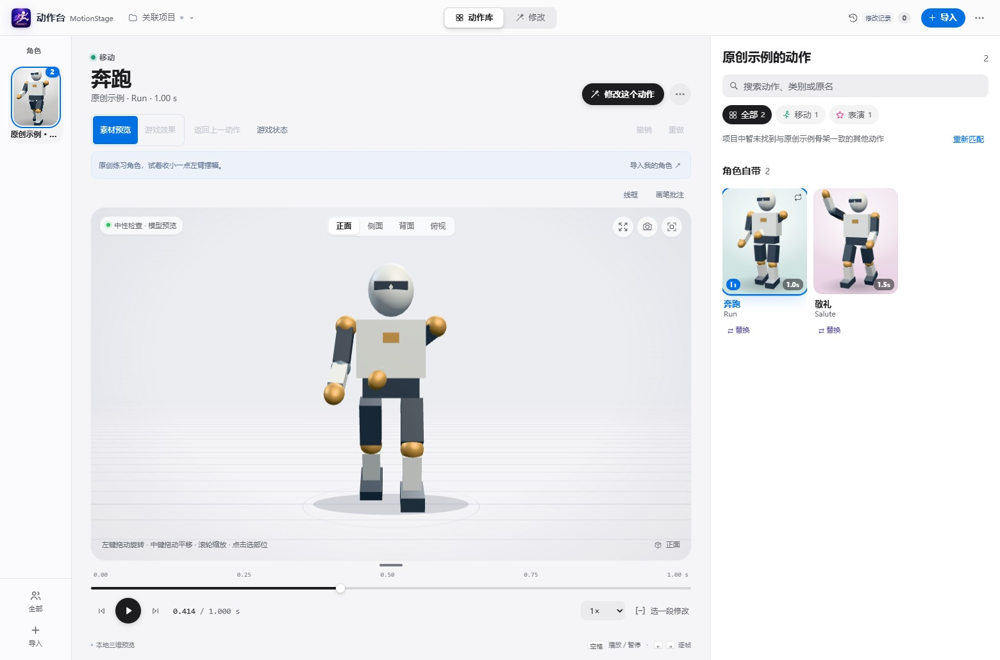
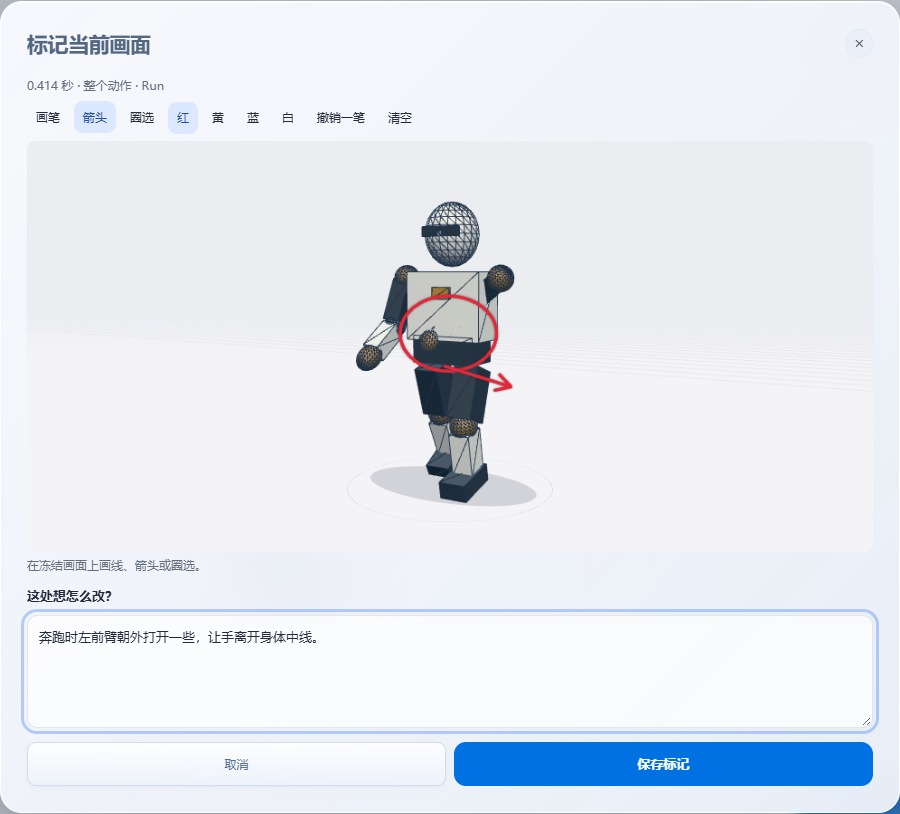
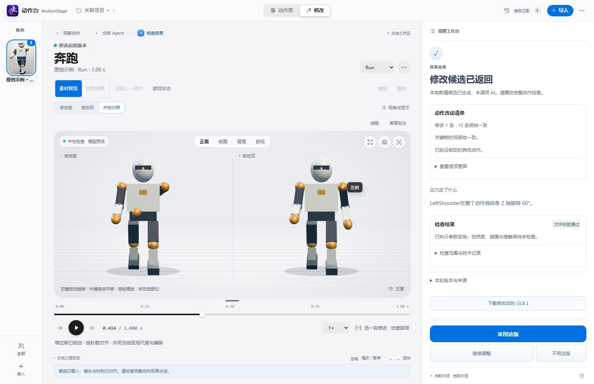

# MotionStage 动作台

在本地浏览器里审阅 3D 角色动作。逐帧查看骨骼和网格，在画面上圈出问题，把修改要求交给 Agent，再用同一时刻、同一镜头比较候选。



## 快速开始

准备 **Node.js 22+** 和支持 **WebGL2** 的浏览器。查看 GLB、播放自带练习人偶和本地微调可直接使用。导入 FBX 需要本机安装 **Blender 4.2+**，动作台会调用它转换预览文件。

```sh
git clone https://github.com/yougui0/motion-stage.git
cd motion-stage
node skill/scripts/start.mjs
```

Windows 也可以双击 `skill/Open MotionStage.cmd`，macOS 可以双击 `skill/Open MotionStage.command`。启动后保持终端运行。右上角 **「…」→「界面语言」** 可切换简体中文或 English。

**English** · Run the commands above with Node.js 22+ and a WebGL2 browser. Choose **… → Interface language → English** after opening the workbench. Blender 4.2+ is required for FBX import.

## 查看并标记动作

1. **挑选动作**。点「导入」打开角色，或从左上角「关联项目」浏览项目角色和兼容动作。点动作卡片播放，按空格暂停，用方向键逐帧查看。
2. **检查网格和姿势**。左键拖动旋转视角，中键拖动平移，滚轮缩放。可拖动预览下方的手柄调整高度，也可以打开全屏预览。用「线框」检查变形处的三角网格，在「视角与显示」中可切换到全部网格。
3. **标记问题**。在有问题的时刻点击「画笔批注」，用线条、箭头或圈选指出位置，补充希望怎么改。每条标记都带着当前画面、时间和镜头。可以把几处问题一起提交。



## 修改与审阅

- **提交任务**。在「修改」里填写要求，选好部位和时间范围，再复制任务给当前对话。也可以选「本机后台处理」，使用已配置的 Codex CLI、Claude Code 或 DeepSeek Harness。
- **做简单微调**。展开「本地微调」，选中有旋转轨道的部位，设置摆动幅度或局部旋转偏移，试播后生成候选。
- **检查结果**。并排播放原动作和候选，点反馈标记可以回到同一时间和镜头。确认后选择「采用这版」「继续调整」或「不用这版」。可以下载候选 GLB。采用后可通过「接入游戏…」安排项目接入，再在游戏中验证效果。



## 工作区与 Agent Skill

独立使用时，素材、草稿和候选默认保存在 `~/motion-stage-workspace/`。关联游戏项目后，工作区位于 `<项目>/.motion-studio/`。通过「素材详情 → 删除素材…」可以从工作区列表移除素材。

也可以在启动时直接指定游戏项目。

```sh
node skill/scripts/start.mjs --project "/absolute/path/to/game"
```

如需在 Codex 中使用 `$motion-stage`，从仓库根目录运行下面的命令，再打开新对话。安装目标须是新目录。Claude Code 的目标目录是 `$HOME/.claude/skills/motion-stage`。在 Windows PowerShell 中用 `$env:USERPROFILE` 表示用户目录。

```sh
node skill/scripts/motion-feedback.mjs install --target "$HOME/.codex/skills/motion-stage"
```

- [启动、导入与排错](skill/references/setup.md) · [动作库](skill/references/action-library.md) · [项目工作区](skill/references/project-workspace.md)
- [任务流程、CLI 与 MCP](skill/references/agent-workflow.md) · [接入游戏](skill/references/game-integration.md)

## 开发与许可

`skill/` 包含应用和 Agent Skill。在仓库根目录运行 `npm --prefix skill test` 执行测试，运行 `python3 tools/package-skill.py` 生成发行包。验证流程见 [CI 文档](tools/ci/README.md)。

本项目基于 [jbang2004/motion-stage](https://github.com/jbang2004/motion-stage)。代码和原创练习资源采用 [MIT 许可](skill/LICENSE)，随包运行时的声明见 [第三方许可](skill/THIRD_PARTY.md)。
