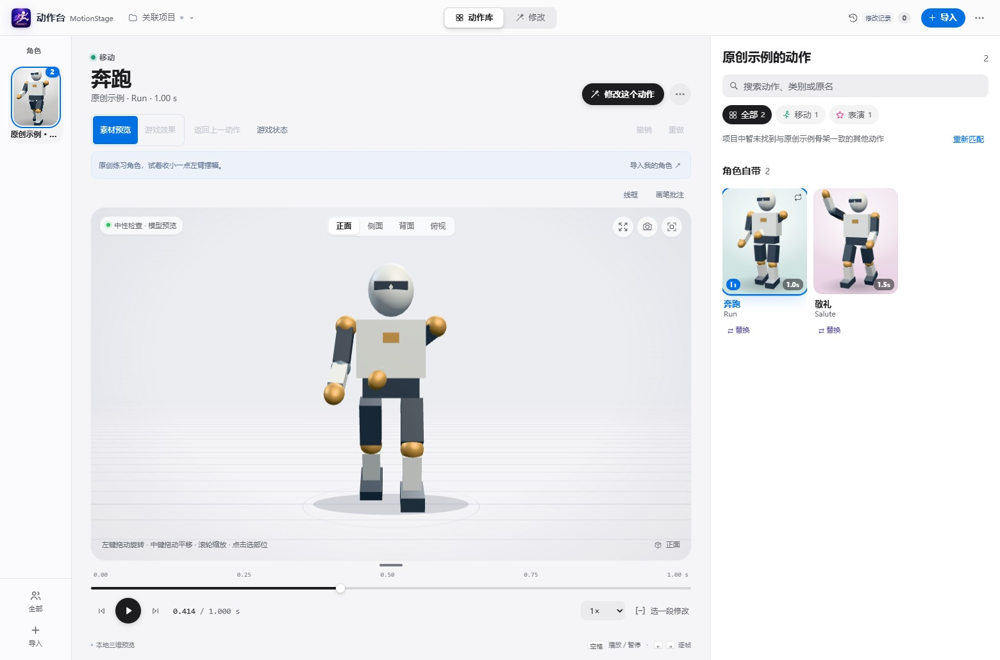
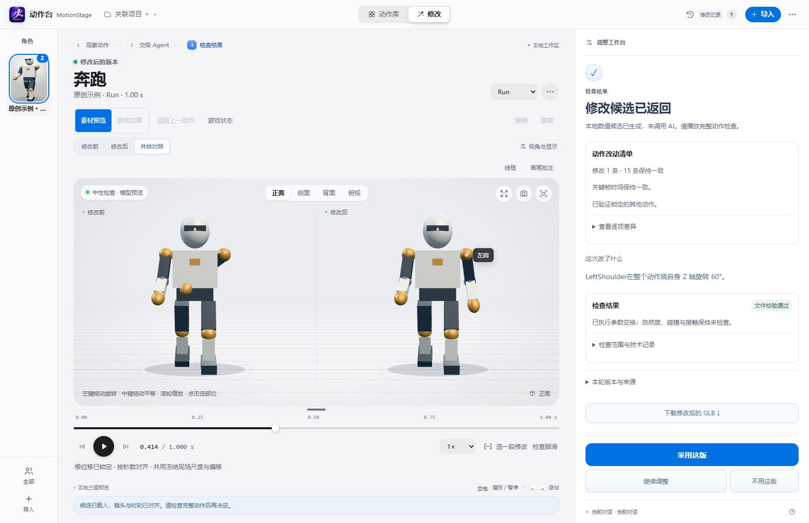

# MotionStage 动作台

在本地浏览器里查看角色动作、检查网格、在指定时刻画批注，再并排审阅修改候选。



## 启动

在此目录运行以下命令。需要 **Node.js 22+** 和支持 **WebGL2** 的浏览器。Windows 可双击 `Open MotionStage.cmd`，macOS 可双击 `Open MotionStage.command`。

```sh
node scripts/start.mjs
```

首次启动会载入练习人偶。导入 FBX 另需 **Blender 4.2+**。右上角「…」→「界面语言」可切换简体中文和 English。

## 审阅动作

1. 在动作库选择角色和动作，暂停在目标时刻。左键拖动旋转，中键拖动平移，滚轮缩放。可调整预览高度、全屏查看或打开线框。
2. 点击「画笔批注」，在冻结画面上画线、箭头或圈选，填写修改说明。将一个或多个标记一起保存并交给 Agent。只需数值调整时，也可用「本地微调」生成候选。
3. 候选返回后并排比较，选择「采用这版」「继续调整」或「不用这版」。



独立工作区默认在 `~/motion-stage-workspace/`。运行 `node scripts/start.mjs --project "/absolute/path/to/game"` 可打开项目工作区 `<项目>/.motion-studio/`。

## 安装为 Agent Skill

从此目录运行以下命令，然后在新对话调用 `$motion-stage`。安装目标须是新目录。Claude Code 的目标目录是 `$HOME/.claude/skills/motion-stage`。在 Windows PowerShell 中用 `$env:USERPROFILE` 表示用户目录。

```sh
node scripts/motion-feedback.mjs install --target "$HOME/.codex/skills/motion-stage"
```

- [安装与排错](references/setup.md) · [动作库](references/action-library.md)
- [Skill 入口](SKILL.md) · [任务流程与 CLI / MCP](references/agent-workflow.md) · [接入游戏](references/game-integration.md)

基于 [jbang2004/motion-stage](https://github.com/jbang2004/motion-stage)。代码与原创练习资源采用 [MIT 许可](LICENSE)，另见 [第三方许可](THIRD_PARTY.md)。
